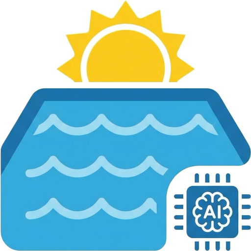

# SolarPool AI ☀️🏊

<p align="center">
  
</p>

[](https://github.com/hacs/integration)
[](https://github.com/pabloantonelli/solar-pool-ai/releases)

**Calentá tu pileta con el sol, sin pensar en la bomba.**

Si tenés colectores solares en el techo, SolarPool AI decide por vos cuándo prender la bomba para que el agua pase por el techo y vuelva más caliente. Y cuándo apagarla, para no gastar luz de más. Funciona dentro de Home Assistant, sin internet y sin costos.

---

## ✨ Qué hace por vos

- ☀️ **Aprovecha cada rato de sol.** Prende la bomba solo cuando el techo realmente está calentando el agua.
- 💡 **Ahorra luz.** Apaga en cuanto el agua deja de volver caliente (nubes, viento, atardecer).
- 🧠 **Aprende de tu casa.** Con los días se da cuenta de en qué condiciones conviene y en cuáles no vale la pena ni probar.
- 🤝 **Respeta tu filtrado.** Si la bomba ya estaba prendida filtrando, nunca la apaga.
- 🌡️ **No se pasa de temperatura.** Corta al llegar a la temperatura máxima que elijas.
- ❄️ **Cuida la instalación en invierno** (opcional). Hace circular el agua cuando hay riesgo de helada.
- 🌙 **Enfría la pileta de noche** (opcional). Si en verano se pasó de temperatura, usa el techo como radiador.
- 🚨 **Te avisa si algo anda mal.** Por ejemplo, un sensor que dejó de responder o colectores que rinden poco.
- 🗣️ **Te explica qué está haciendo**, en criollo: *"☀️ Sol fuerte y viento calmo. ¡Aprovechamos al máximo!"*

## 🔄 Cómo funciona (en simple)

1. **Cada 10 minutos, de día**, se pregunta si vale la pena revisar el techo, mirando el sol, las nubes y el viento.
2. **Si vale la pena, mide.** Prende la bomba un par de minutos y compara el agua que vuelve del techo con la de la pileta.
3. **Si vuelve más caliente, sigue calentando** y controla cada minuto. Cuando la diferencia se achica, apaga.
4. **Aprende del resultado.** Si medir en esas condiciones sirvió, la próxima vez lo hace igual; si no sirvió, la próxima vez se ahorra la medición.

> La bomba nunca queda menos de 10 minutos encendida, para no castigarla con arranques cortos.

---

## 🛠️ Instalación

1. En Home Assistant abrí **HACS** → menú ⋮ → **Repositorios personalizados**
2. Pegá `https://github.com/pabloantonelli/solar-pool-ai` y elegí **Integración**
3. Buscá **SolarPool AI**, instalala y reiniciá Home Assistant
4. Andá a **Ajustes → Dispositivos y servicios → Añadir integración → SolarPool AI**

### Qué te va a pedir
| Necesitás | Para qué |
|---|---|
| 🔌 El **switch de la bomba** | Prenderla y apagarla |
| 🌡️ Un **sensor de temperatura de la pileta** | Saber cuánto calienta |
| 🌡️ Un **sensor de temperatura del retorno** (el caño que vuelve del techo) | Saber si el techo está calentando |
| 🌤️ Una **entidad de clima** (la que ya tengas) | Sol, nubes, viento y temperatura exterior |
| *(Opcional)* sensores de UV, nubes, viento o temperatura exterior | Más precisión si tenés estación meteorológica |

---

## 🎛️ Modos

Elegilos desde el selector **Modo**:

| Modo | Cuándo usarlo |
|---|---|
| **Automático** | El de todos los días. Calienta cuando rinde. |
| **Eco (ahorro)** | Solo calienta con condiciones muy buenas. Gasta menos luz y calienta un poco menos. |
| **Boost (calentar a full)** | Para cuando querés la pileta lo más caliente posible ese día (por ejemplo, viene gente mañana). Al atardecer vuelve solo a Automático. |
| **Pausa (solo protecciones)** | Vacaciones o temporada sin uso. No calienta, pero si activaste el antiheladas o el enfriamiento nocturno, siguen funcionando. |

El interruptor **Automatización** apaga todo, incluidas las protecciones.

## ⚙️ Ajustes

Están en la tarjeta del dispositivo, en **Configuración**. Los valores por defecto andan bien para la mayoría.

| Ajuste | Qué hace | ¿Cuándo tocarlo? |
|---|---|---|
| **Temperatura máxima** | Deja de calentar al llegar a esta temperatura | A gusto (por defecto 32 °C) |
| **ΔT para encender** | Cuánto más caliente tiene que volver el agua del techo para empezar a calentar | Subilo si sentís que prende "por poco" (por defecto 2 °C) |
| **ΔT para apagar** | Si la diferencia baja de esto, apaga | Subilo para ahorrar más, bajalo para exprimir más el sol (por defecto 1 °C) |
| **Duración máxima de medición** | Cuánto tiempo, como máximo, deja la bomba prendida para medir | Si tus caños al techo son largos y el agua caliente tarda en llegar, subilo (por defecto 3 min) |
| **Antiheladas** + **Umbral** | Hace circular el agua 10 min cada media hora si afuera baja del umbral | Activalo si en tu zona hiela |
| **Enfriamiento nocturno** | De noche, si la pileta se pasó de la máxima, la enfría usando el techo | Activalo si en verano se te calienta de más |

## 📊 Qué vas a ver

- **Estado**: qué está haciendo ahora (En reposo, Midiendo el techo, Calentando, Antiheladas…)
- **Razonamiento**: el porqué, en una frase
- **ΔT colectores**: cuánto más caliente vuelve el agua del techo
- **Ganancia del día**: cuántos grados subió la pileta hoy
- **Problema**: se enciende si algo anda mal. Adentro dice qué pasa.
- **Medir ahora**: botón para que revise el techo en el momento
- En **Diagnóstico** vas a encontrar cómo viene el aprendizaje (sesiones aprendidas, fase, etc.)

### 📱 Recibir un aviso en el celular si hay un problema

```yaml
alias: "Aviso de problema en la pileta"
triggers:
  - trigger: event
    event_type: solarpool_ai_problem
actions:
  - action: notify.notify
    data:
      title: "🏊 Pileta"
      message: "{{ trigger.event.data.message }}"
```

> También existe el evento `solarpool_ai_session_ended` (cuando termina de calentar, con los grados ganados), por si querés armar un resumen.

---

## ❓ Preguntas frecuentes

**¿Me va a apagar la bomba mientras filtra?**
No. Solo apaga la bomba si la prendió él. Si ya estaba prendida, la aprovecha para medir gratis y la deja como estaba.

**¿Por qué prende la bomba un par de minutos y la apaga?**
Estaba midiendo el techo. Con la bomba apagada, el agua del caño está quieta y no dice nada; hay que hacerla circular para saber si el techo está caliente. Si no convenía, apaga (después del mínimo de 10 min). Con el tiempo aprende a hacer menos mediciones inútiles.

**¿Qué pasa si se reinicia Home Assistant mientras calienta?**
Al volver retoma el calentamiento si sigue habiendo sol, o apaga la bomba. Nunca queda prendida "huérfana".

**¿Si apago la bomba a mano, se pelea conmigo?**
No. Se da cuenta, suelta la bomba y recién vuelve a evaluar en el próximo ciclo.

**¿Necesita internet o una cuenta de IA?**
No. Todo corre dentro de tu Home Assistant.

**Algunas entidades aparecen en inglés**
Los nombres siguen el idioma del servidor de Home Assistant (*Ajustes → Sistema → General*). Los mensajes del Razonamiento usan el idioma que elegiste al configurar la integración.

---

## 📋 Historial de versiones

| Versión | Cambios principales |
|---------|---------------------|
| **0.2.0** | 🎛️ Nuevo modo **Eco**; "Vacaciones" ahora se llama **Pausa (solo protecciones)**. 🌍 Todas las entidades traducidas. ⏱️ El intervalo de consulta pasa a ser automático (cada 10 min). 📖 README más simple. |
| **0.1.0** | 🔥 Calienta midiendo la temperatura real del agua que vuelve del techo, y aprende cuándo vale la pena medir (el aprendizaje arranca de cero). 🎛️ Modos Automático, Boost y Vacaciones. ❄️ Antiheladas y 🌙 enfriamiento nocturno. 🚨 Aviso de problemas. 🐛 Arreglos: el slider de temperatura máxima ahora funciona, la bomba no queda prendida tras reiniciar y recargar la integración no duplica ciclos. |
| **0.0.10** | 🎨 **Ícono propio**: La integración incluye su ícono en `brand/` (PNG transparente); Home Assistant 2026.3+ lo muestra automáticamente. |
| **0.0.9** | 🐛 **Bugfix**: La integración quedaba en "No cargado" en versiones recientes de Home Assistant (`TypeError: expected str, got list`). Los textos propios se movieron de `translations/` a `messages/`. |
| **0.0.8** | 🐛 **Bugfix**: El estado del switch Master se mantiene después de reiniciar Home Assistant. |
| **0.0.7** | ☁️ **Nubosidad**: Sensor opcional de cobertura de nubes para calcular el UV efectivo. |
| **0.0.6** | 📡 **Sensores Opcionales**: Mapeo de sensores UV/viento/temperatura independientes. ☀️ **Estimación UV**: Cálculo automático basado en elevación solar. 🌍 **Traducciones JSON**: Migración a formato estándar de Home Assistant. |
| **0.0.5** | 🐛 **Bugfix**: Corregida pérdida de propiedad de la bomba (ahora se apaga correctamente tras el calentamiento). |
| **0.0.4** | 📊 Nuevo sensor de **Ganancia Diaria Total** (seguimiento térmico de la jornada). |
| **0.0.3** | 🧠 IA: Proxy de radiación solar (estimación UV por altura sol) y reajuste de recompensas. |
| **0.0.2** | 🛡️ Protección de bomba compartida (no apaga si ya estaba filtrando) y disparo inmediato al activar Master. |
| **0.0.1** | 🚀 Lanzamiento inicial BETA: Reinforcement Learning Local, Análisis de Ventana, Multilenguaje Regional y UI Optimizada. |


---

🔧 ¿Querés saber cómo funciona por dentro? Mirá [`CLAUDE.md`](CLAUDE.md) (documentación técnica).
