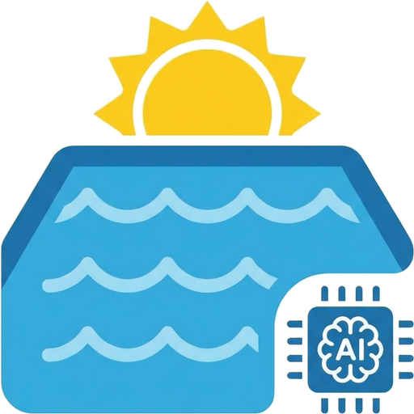
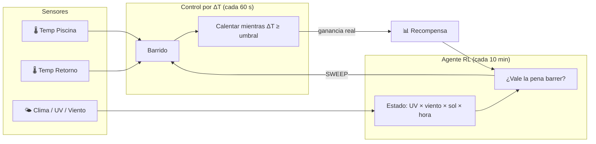
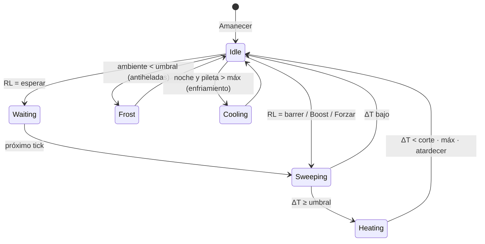

# SolarPool AI (Home Assistant Custom Component)

<p align="center">
  
</p>

[](https://github.com/hacs/integration)
[](https://github.com/pabloantonelli/solar-pool-ai/releases)

SolarPool AI es una integración para Home Assistant que automatiza la climatización de piscinas con colectores solares. Calienta midiendo el **ΔT real de los colectores** y usa **aprendizaje por refuerzo local** para saber cuándo vale la pena prender la bomba a medir. Sin APIs externas.

## 🚀 Características

- **🧠 Reinforcement Learning Local**: Aprende de tu sistema específico sin depender de APIs externas
- **⏱️ Monitoreo de Alta Frecuencia**: Ciclos cada 10 min para una respuesta inmediata a cambios de clima
- **⚖️ Análisis de Ventana (Estabilidad)**: Algoritmo de varianza que asegura lecturas térmicas reales en cualquier sensor
- **🛡️ Protección de Bomba**: Tiempo mínimo de ejecución (10 min) para evitar arranques frecuentes
- **🌍 Políglota Regional**: Soporte para Español (Arg/Esp), Inglés, Portugués (Br), Francés y Alemán
- **📡 Sensores Opcionales**: Mapea sensores específicos de UV, viento o temperatura ambiente (v0.0.6)
- **☀️ Estimación Inteligente de UV**: Calcula UV automáticamente basándose en la elevación solar si no hay datos (v0.0.6)
- **🎨 UI Limpia**: Entidades categorizadas en Principal, Configuración y Diagnóstico
- **💰 Cero Costos**: Sin gastos en APIs de IA (anteriormente $6-60/mes)
- **⚡ Respuestas Instantáneas**: Decisiones en microsegundos vs 1-3 segundos con LLMs
- **🔒 100% Offline**: Funciona sin conexión a internet
- **🔥 Control por ΔT con histéresis (v0.1.0)**: calienta mientras el agua vuelve del techo al menos `ΔT para apagar` más caliente; sin duraciones fijas
- **🎛️ Modos (v0.1.0)**: Automático, Boost (calentar a full hasta el atardecer) y Vacaciones
- **❄️ Antiheladas y 🌙 Enfriamiento nocturno (v0.1.0)**: protecciones opcionales que usan los colectores
- **🚨 Detección de problemas (v0.1.0)**: sensores caídos, bomba que no responde, retorno trabado o colectores rindiendo poco
- **🛡️ Seguridad Multicapa**:
  - La bomba es compartida con el filtrado: SolarPool nunca apaga una bomba que no prendió
  - Si Home Assistant se reinicia mientras calienta, retoma o apaga la bomba (no queda prendida)
  - Tiempo mínimo de bomba (10 min) y corte por temperatura máxima
  - Apagado automático al atardecer

## 🏗️ Arquitectura



> Detalle técnico completo en [`CLAUDE.md`](CLAUDE.md).

## 🛠️ Instalación mediante HACS

1. Abre **HACS** en tu instancia de Home Assistant
2. Ve a **Integraciones**
3. Haz clic en los tres puntos → **Repositorios personalizados**
4. Pega: `https://github.com/pabloantonelli/solar-pool-ai`
5. Selecciona **Integración** y haz clic en **Añadir**
6. Busca "SolarPool AI" e instálala
7. Reinicia Home Assistant

## ⚙️ Configuración

Ve a **Ajustes** > **Dispositivos y Servicios** > **Añadir Integración** > **SolarPool AI**

Necesitarás configurar:

### Entidades Requeridas
- **Bomba de piscina** (switch)
- **Sensor de temperatura piscina**
- **Sensor de temperatura retorno** (de colectores)
- **Entidad de clima** (weather)

### Sensores Opcionales (v0.0.6)
Podés mapear sensores específicos en vez de usar los atributos del clima:
- **Sensor UV** - Por ejemplo: `sensor.pirateweather_uv_index`
- **Sensor de viento** - Por ejemplo: `sensor.estacion_meteo_wind_speed`
- **Sensor de temperatura ambiente**

> 💡 **Prioridad de lectura UV**: Sensor configurado → Atributo weather → Estimación automática por elevación solar

### Parámetros
- **Idioma**: Español (Argentina/España), English, Português, Français o Deutsch
- **Barrido máximo**: Timeout para estabilización de lecturas
- **Temperatura máxima**: Límite donde se detiene el calentamiento
- **Intervalo de consulta**: Frecuencia de evaluación

> ⚠️ **No requiere API Keys** - El sistema aprende localmente usando Reinforcement Learning

## 📊 Entidades Expuestas

### Operación (Principales)
| Entidad | Descripción |
|---------|-------------|
| `sensor.solarpool_status` | Estado actual traducido (atributos: modo, última sesión, umbrales) |
| `sensor.solarpool_reasoning` | **Explicación narrativa** de la decisión actual |
| `sensor.solarpool_total_daily_gain` | **Ganancia acumulada hoy** (°C) |
| `sensor.solarpool_ai_collector_dt` / `..._dt_colectores` | **ΔT colectores** (retorno − pileta) medido con la bomba en marcha |
| `sensor.solarpool_next_run` | Próxima evaluación automática |
| `sensor.solarpool_expected_gain` | Ganancia esperada por hora de calentamiento (aprendida) |
| `select.solarpool_ai_modo` | Modo: Automático / Boost / Vacaciones |
| `binary_sensor.solarpool_ai_problema` | ON si hay un problema (atributo `reasons` con el detalle) |
| `switch.solarpool_master` | Habilitar/Deshabilitar toda la automatización (incluye protecciones) |

### Parámetros (Categoría: Configuración)
| Entidad | Descripción | Rango |
|---------|-------------|-------|
| Temperatura Máxima | Temperatura máxima del agua | 20-40°C |
| Barrido Máximo | Timeout de barrido (Análisis de Ventana) | 60-600s |
| Intervalo de Consulta | Frecuencia de evaluación | 5-120min |
| ΔT para encender | ΔT mínimo tras el barrido para calentar (default 2.0) | 0.5-6°C |
| ΔT para apagar | Corte por histéresis (default 1.0) | 0.2-4°C |
| Antiheladas | Circula 10 min cada 30 si el ambiente baja del umbral | On/Off |
| Umbral antiheladas | Temperatura ambiente de activación (default 2°C) | -5-8°C |
| Enfriamiento nocturno | Usa los colectores como radiador si la pileta superó la máxima | On/Off |

### Diagnóstico
| Entidad | Descripción |
|---------|-------------|
| `sensor.solarpool_rl_phase` | Fase de aprendizaje |
| `sensor.solarpool_rl_episodes` | Sesiones aprendidas |
| `sensor.solarpool_rl_exploration_rate` | Tasa de exploración |
| `sensor.solarpool_rl_last_reward` | Recompensa de la última sesión |
| Botón "Forzar consulta" | Barrido inmediato |

> Los IDs de las entidades nuevas dependen del idioma de tu Home Assistant al instalarlas.

### Eventos para automatizaciones
- `solarpool_ai_session_ended`: al terminar de calentar (`gain`, `heating_minutes`, `pump_minutes`, `daily_gain`).
- `solarpool_ai_problem`: al detectar un problema (`problem`, `message`). Ideal para notificaciones.

## 🧠 Cómo Decide

### 1. ¿Barro ahora? (agente RL, cada 10 min)
Barrer (prender la bomba unos minutos para medir el agua del techo) cuesta energía. El agente aprende, según las condiciones, si suele valer la pena:
- **Estado** (108 combinaciones): UV efectivo (4) × viento (3) × elevación solar (3) × hora respecto del mediodía solar (3)
- **Acciones**: `WAIT` o `SWEEP`
- **Recompensa** al terminar la sesión: `ganancia_real_°C − 0.05 × horas_de_bomba`, o `−0.1` si el barrido no terminó calentando
- Si pasan más de 60 min sin barrer, barre igual (para no quedar ciego). Si la bomba ya está prendida por el filtrado, siempre mide (es gratis).

| Fase | Sesiones | Comportamiento |
|------|----------|----------------|
| **Bootstrap** | 1-10 | Siempre barre |
| **Entrenamiento** | 11-50 | Exploración decreciente (30% → 5%) |
| **Producción** | 50+ | 5% exploración |

### 2. ¿Caliento? (control por ΔT)
- **Barrido con Análisis de Ventana**: acumula lecturas del retorno y continúa cuando la variación es < 0.2°C (o al llegar al timeout).
- Si `ΔT ≥ ΔT para encender` → calienta **sin duración fija**.
- Cada 60 s mide de nuevo (mediana de 3 lecturas) y corta tras 3 lecturas seguidas bajo `ΔT para apagar`, al llegar a la temperatura máxima o al bajar el sol.
- **Tiempo mínimo de bomba** de 10 min para no castigarla con arranques cortos.

## 🌍 Ejemplos de Explicaciones

### Español 🇪🇸
```
☀️ Sol fuerte y viento calmo. ¡Aprovechamos al máximo!
💨 Viento de 25km/h enfría los colectores.
📉 Solo 1.5°C de diferencia. Necesitamos al menos 2°C.
🤖 Probando nueva estrategia. Después te cuento cómo salió.
```

### English 🇬🇧
```
☀️ Strong sun, calm wind. Let's heat up!
💨 25km/h wind cools the collectors.
📉 Only 1.5°C difference. Need at least 2°C.
🤖 Testing new strategy. I'll report back.
```

## 🔄 Ciclo de Operación



## 📋 Historial de Versiones

| Versión | Cambios principales |
|---------|---------------------|
| **0.1.0** | 🔥 **Motor v2**: calentamiento por ΔT con histéresis + RL que aprende cuándo barrer (se corrigió la atribución de recompensas; el aprendizaje se reinicia). 🎛️ Modos Auto/Boost/Vacaciones. ❄️ Antiheladas y 🌙 enfriamiento nocturno. 🚨 Sensor de problemas y eventos. 🐛 Fixes: el slider de temperatura máxima ahora funciona, la bomba no queda prendida tras un reinicio, recargar la integración no duplica ciclos, se pueden borrar los sensores opcionales. 💾 Estado en `.storage` (ya no en la config entry). |
| **0.0.10** | 🎨 **Ícono propio**: La integración incluye su ícono en `brand/` (PNG transparente); Home Assistant 2026.3+ lo muestra automáticamente. |
| **0.0.9** | 🐛 **Bugfix**: La integración quedaba en "No cargado" en versiones recientes de Home Assistant (`TypeError: expected str, got list`). Los textos propios se movieron de `translations/` a `messages/`. |
| **0.0.8** | 🐛 **Bugfix**: El estado del switch Master se mantiene después de reiniciar Home Assistant. |
| **0.0.7** | ☁️ **Nubosidad**: Sensor opcional de cobertura de nubes para calcular el UV efectivo. |
| **0.0.6** | 📡 **Sensores Opcionales**: Mapeo de sensores UV/viento/temperatura independientes. ☀️ **Estimación UV**: Cálculo automático basado en elevación solar. 🌍 **Traducciones JSON**: Migración a formato estándar de Home Assistant. |
| **0.0.5** | 🐛 **Bugfix**: Corregida pérdida de propiedad de la bomba (ahora se apaga correctamente tras el calentamiento). |
| **0.0.4** | 📊 Nuevo sensor de **Ganancia Diaria Total** (seguimiento térmico de la jornada). |
| **0.0.3** | 🧠 IA: Proxy de radiación solar (estimación UV por altura sol) y reajuste de recompensas. |
| **0.0.2** | 🛡️ Protección de bomba compartida (no apaga si ya estaba filtrando) y disparo inmediato al activar Master. |
| **0.0.1** | 🚀 Lanzamiento inicial BETA: Reinforcement Learning Local, Análisis de Ventana, Multilenguaje Regional y UI Optimizada. |

---

**Nota**: Este componente utiliza Reinforcement Learning local. No requiere conexión a internet ni APIs externas para funcionar.
